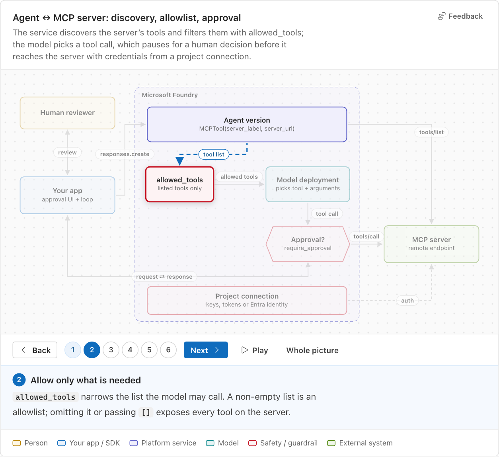
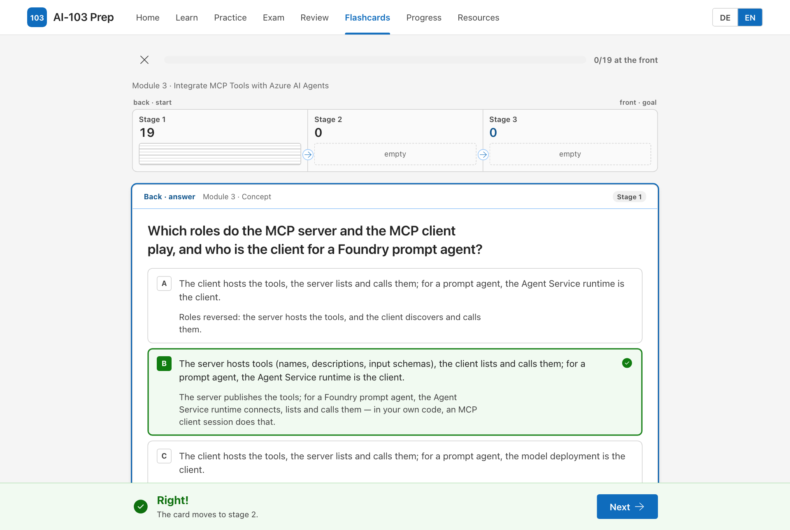
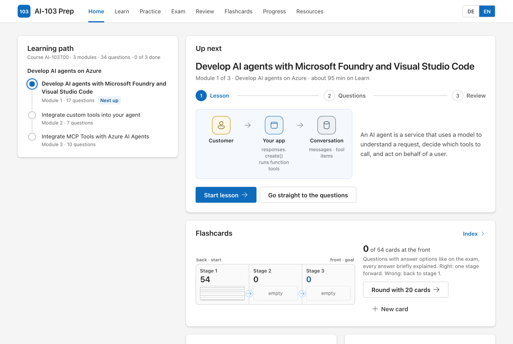
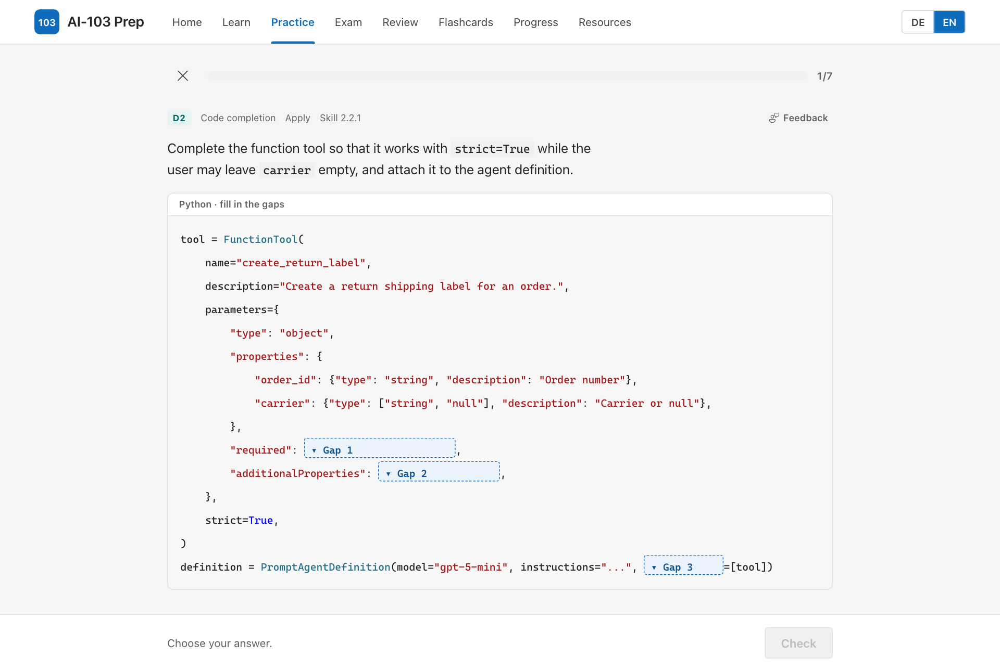

# exam-prep-app: an agent skill for Microsoft certification study apps

An [agent skill](https://docs.github.com/copilot/concepts/agents/about-agent-skills) that turns any Microsoft certification exam (AZ-104, AI-102, DP-700, SC-300 and so on) into an illustrated study web app. The app is built from **current Microsoft Learn content**, with **original questions** and no exam dumps, and is deployed to **GitHub Pages** as an installable, offline-capable PWA.

You ask your agent, for example in the GitHub Copilot app, Copilot CLI or VS Code agent mode:

> Build me a study app for exam AZ-104 and publish it to GitHub Pages.

The agent then:

1. finds the exam page, the study guide (skills measured), the official course with its learning paths and modules, and the exam format on Microsoft Learn;
2. scaffolds the bundled app template and maps every skills-outline bullet to the modules that teach it, which gives the coverage matrix;
3. writes a gold-standard module with you, then the rest. With sub-agents this runs in parallel batches, and every fact is checked on Learn;
4. runs one independent fact-check round and one delta check, plus automated quality gates;
5. publishes the app and reports question counts, coverage and anything it couldn't verify.

| Lesson with a step-through diagram | Flashcards with a reason for every option |
|---|---|
|  |  |
| **Home: the guided path, up next, flashcards and exam readiness** | **Practice: a code completion question in the exam's language** |
|  |  |

The screenshots show the template's sample content: three modules of an AI-103 study app.

## What the app includes

- **A lesson per course module:** summary, exam focus, step-through SVG diagrams, core concepts, a "which service for which task" table, minimal code, exam traps, takeaways and links to the official module.
- **Original question bank:**
  - single choice, multiple select, ordering, matching, code completion and case studies;
  - every option explains why it is right or wrong, and every question cites current learn.microsoft.com sources;
  - weighted like the skills outline.
- **Learn mode, practice filters** (domain, module, skill, difficulty, type), a **timed exam simulation** weighted by domain, and **spaced repetition** of mistakes.
- **Flashcards** ("Zettelkasten" in the German UI): a 3-compartment Leitner box with one 4-option card per concept, trap and takeaway, each option with a reason.
- **Progress** per domain and module, a **coverage matrix** and a **resources** page: study guide, course, practice assessment, exam sandbox.
- **Feedback links** on every question, lesson section, diagram, code sample and card. Each opens a prefilled GitHub issue in the app's repository.
- **English and German** interface and content. No backend and no account; progress stays in the browser, with export and import.
- **Quality gates:**
  - **Content validator:** coverage, sources, legacy product names, model retirement dates, diagram geometry, and answer-cue rules so you can't guess keys from their form;
  - **Tests and a diagram render audit;**
  - **Deployment blocked** unless everything passes.

## Install

Inspect a skill before you install it:

```sh
gh skill preview jeffrey-groneberg/exam-prep-app-skill exam-prep-app
gh skill install jeffrey-groneberg/exam-prep-app-skill exam-prep-app
```

`gh skill` needs GitHub CLI 2.90 or later and is in public preview. You can also copy `skills/exam-prep-app/` into `~/.copilot/skills/` (personal) or into `.github/skills/` of a repository (project). Other agents that support the [Agent Skills](https://github.com/agentskills/agentskills) format work the same way, for example `~/.claude/skills/`.

### Prerequisites

- **Microsoft Learn MCP server** (free, no sign-in), added to your agent:

  ```json
  { "microsoft.docs.mcp": { "type": "http", "url": "https://learn.microsoft.com/api/mcp" } }
  ```

  Without it, the skill falls back to the [`mslearn` CLI](https://www.npmjs.com/package/@microsoft/learn-cli) (`npx @microsoft/learn-cli`).
- **Node.js 26 or later, Git and the GitHub CLI.** Playwright is optional, for the visual check and the diagram audit.
- **Shell access for the agent:** it runs `node`, `npm`, `git` and `gh` commands. Approve them when it asks.

## Try the template

The template ships with a small sample: three modules of an AI-103 study app (lessons with diagrams, 34 questions, 54 cards and one case study).

```sh
cd skills/exam-prep-app/assets/app-template
npm ci
npm run dev        # http://localhost:5173
npm run check      # lint, types, tests, content validator
```

To start a new exam by hand, without an agent:

```sh
node skills/exam-prep-app/scripts/learn-catalog.mjs AZ-104T00 --out catalog.json
node skills/exam-prep-app/scripts/new-app.mjs --target ../az-104-prep --code AZ-104 \
  --title "Microsoft Azure Administrator" --course AZ-104T00 --catalog catalog.json --repo <owner>/az-104-prep
```

## Repository layout

```
skills/exam-prep-app/
├── SKILL.md                  # entry point: rules, workflow, tools
├── references/               # playbook: scope discovery, content policy, authoring,
│   └── briefs/               #   diagrams, orchestration, quality gates, publishing, sub-agent briefs
├── scripts/
│   ├── learn-catalog.mjs     # course number → learning paths → modules (public Learn Catalog API)
│   ├── new-app.mjs           # scaffold a new exam app from the template
│   └── card-stats.mjs        # answer-cue statistics for the flashcards
└── assets/app-template/      # the app (Vite, React, TypeScript) with sample content
```

## Content policy

- **No exam dumps.** The skill never uses dump sites or leaked questions. The [Microsoft Certification Exam – Candidate Agreement](https://learn.microsoft.com/credentials/support/certification-exam-candidate-agreement) forbids braindump material.
- **No copies** of Learn module knowledge checks or the official Practice Assessment. The apps link to them instead.
- **Original wording.** All lessons, questions and cards are written in the skill's own words from current Microsoft Learn pages, and each question cites its sources.
- **Unofficial.** Apps built with this skill are study aids. They don't contain real exam questions, and their score isn't Microsoft's scaled score.

## Sharing what you build

Built an app for an exam? Share its GitHub Pages link with colleagues. Each app is a separate repository; for another exam, run the skill again rather than forking an existing app. Feedback and improvements to the skill are welcome as issues or pull requests.

## Disclaimer

Community project, not affiliated with or endorsed by Microsoft. Microsoft, Azure, Microsoft Learn and other product names are trademarks of their respective owners and are used only to describe the products. Exam details change; the skill always works from the current Microsoft Learn pages, and so should you.

## License

[MIT](LICENSE). The template uses [Fluent UI System Icons](https://github.com/microsoft/fluentui-system-icons) (MIT). Product icons in diagrams aren't included; each app downloads official icons under their publisher's terms when it needs them.
